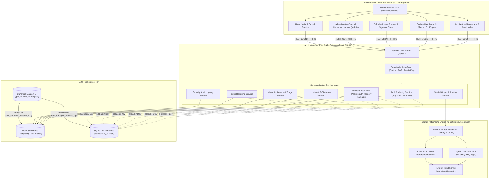
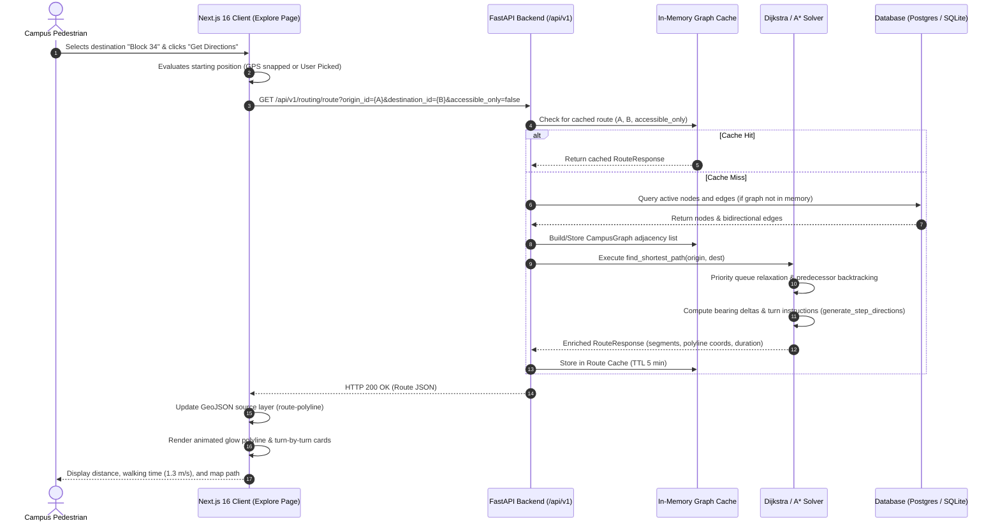
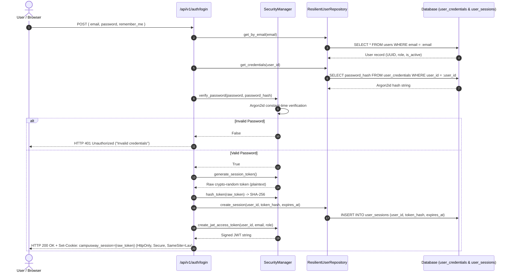
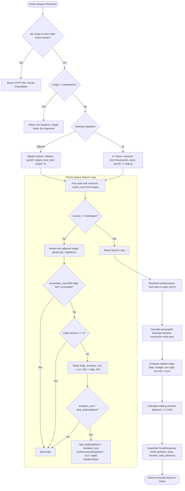
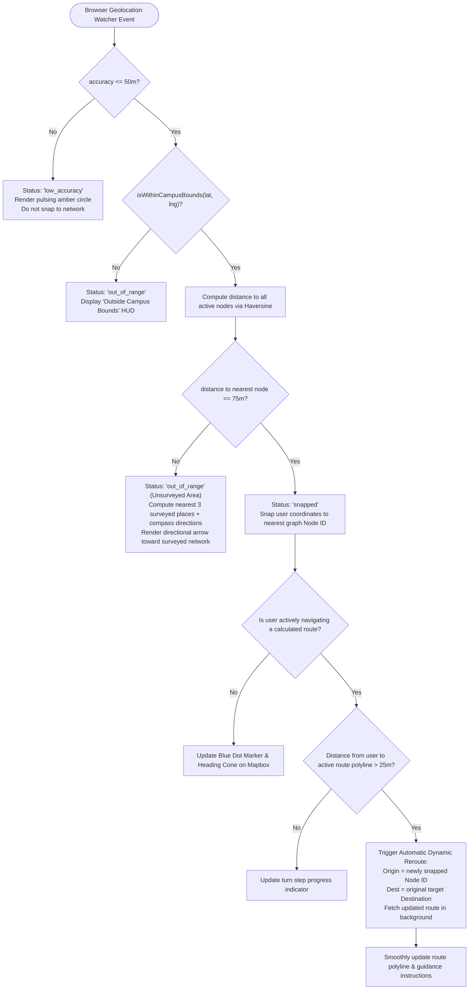
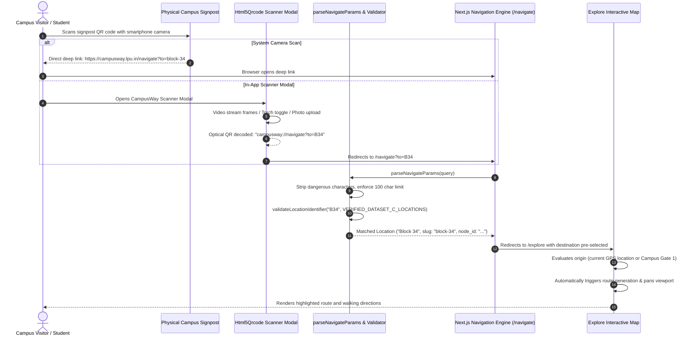
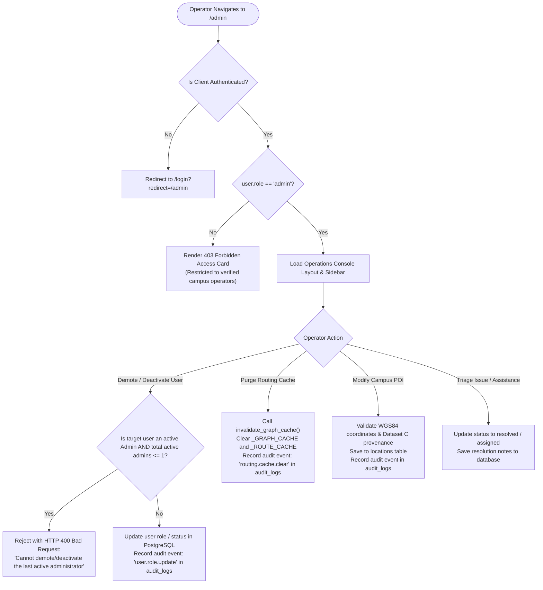
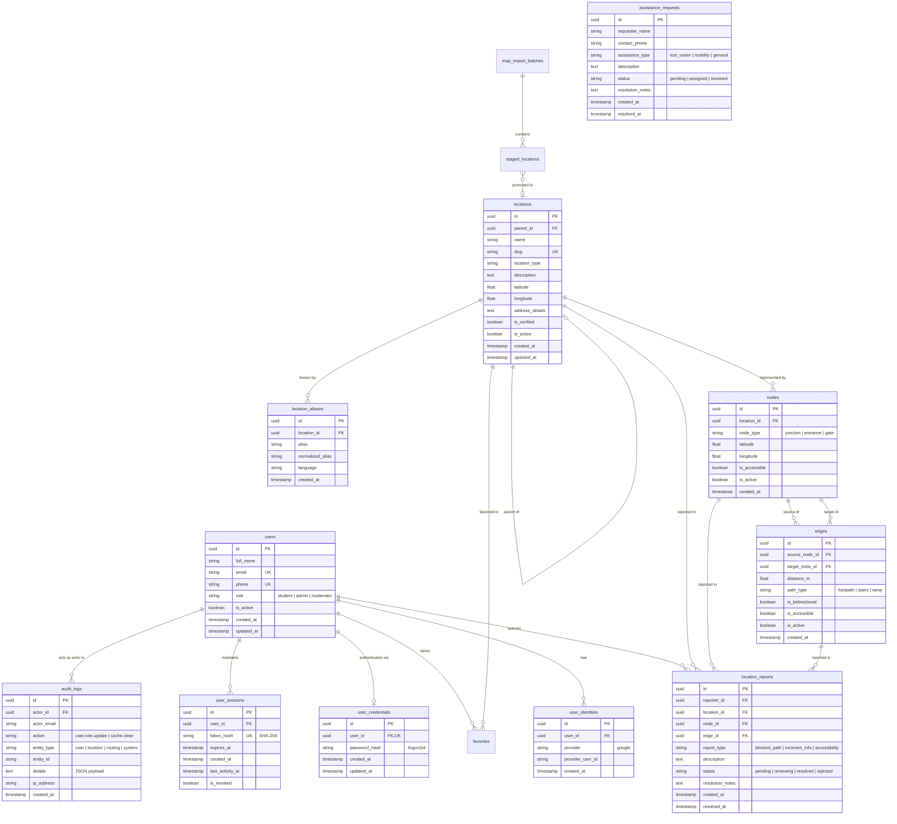

# CampusWay — System Architecture & Workflow Diagrams
**Project:** CampusWay (Lovely Professional University Smart Campus Navigation)  
**Academic Document Reference:** ARCH-DIAG-2026-V1  
**Audit Date:** November 24, 2026  
**Auditor:** Senior Full-Stack Engineering Architect & Academic Documentation Specialist  

---

## 1. High-Level System Architecture

This diagram illustrates the multi-tier architectural topology of CampusWay, showcasing client presentation, reverse-proxy gateway routing, FastAPI service modules, the spatial routing engine, and persistent storage layers.

---

## 2. Frontend / Backend / Database Interaction Flow

This sequence diagram depicts an end-to-end user navigation journey from initial POI lookup through route calculation, database retrieval, caching, and client-side polyline rendering.

---

## 3. Dual-Mode Authentication & Session Security Flow

Demonstrates the cryptographic security pipeline supporting both web session cookies and mobile Bearer tokens with Argon2id password hashing and SHA-256 hashed database sessions.

---

## 4. Campus Navigation & Spatial Routing Pipeline

Detailed operational pipeline of the shortest-path algorithm, walking time estimation, and turn-by-turn direction enrichment.

---

## 5. Real-Time GPS Snapping & Off-Route Rerouting Flow

Depicts the real-time browser Geolocation API interaction, accuracy threshold evaluation, graph snapping, and dynamic reroute triggering.

---

## 6. QR-Based Wayfinding & Deep-Link Resolution Flow

Illustrates destination-encoded physical QR signposts, camera scanner capture, optical decoding, parameter sanitization, and automatic route dispatch.

---

## 7. Administrative Workspace & Security Governance Flow

Flowchart showing administrative operations, role validation, last-admin protection, cache purging, and immutable audit recording.

---

## 8. Database Entity-Relationship (ER) Diagram

Represents the relational database schema implemented in PostgreSQL (Neon) and mirrored in development SQLite, with primary keys, foreign keys, cardinality, and constraints.

