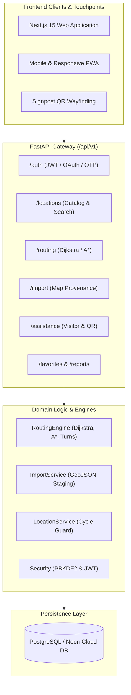

# CampusWay | Campus Navigation & Wayfinding System

> **Campus Wayfinding Engine for Lovely Professional University (LPU), Punjab, India**  
> Solves the numbered block navigation challenge (e.g., *"Which Block is 34?"*) through topological pedestrian graph routing, turn directions, gate QR integrations, and visitor assistance.

---

## 1. System Status & Verification

The CampusWay backend is **production-ready and integration-ready**, fully decoupling backend navigation capabilities from physical campus ground mapping:
- **Test Suite**: **66 passed tests, 0 failures** across authentication, routing, locations, import staging, visitor assistance, favorites, reports, models, and migrations.
- **Database**: PostgreSQL 16 & Neon Cloud single-head migrations (`001_initial_schema_v1` to `004_report_resolution_notes`).
- **Pathfinding**: Predecessor-based Dijkstra & A* algorithms, cardinal bearing calculation, and configurable walking time estimation.
- **Map Ingestion**: Provenance-aware OpenStreetMap & GeoJSON staging pipeline with duplicate detection and administrative review.
- **Docker**: Hardened multi-stage container build with unprivileged execution (`appuser`), service health checks, and compose orchestration.

---

## 2. Key Capabilities & Core Modules

1. **Topological Pedestrian Routing Engine (`/api/v1/routing`)**
   - Point-to-point shortest walking paths using optimized Dijkstra & A* pathfinding.
   - Forward azimuth bearing calculation generating natural turn instructions (*"Turn right onto the corridor"*, *"Take the ramp"*).
   - Wheelchair and mobility accessibility constraints (`accessible_only=true`).
   - Dynamic walking duration estimation based on configurable pedestrian speeds (~1.3 m/s).

2. **Hierarchical Location Catalog (`/api/v1/locations`)**
   - Multi-tier spatial hierarchy (Campus -> Building -> Floor -> Room).
   - Cycle prevention and safe cascading soft-deactivation.
   - Dual-mode search ranking exact matches above partial and normalized alias matches.
   - Dedicated administrative verification workflow (`/verify`) maintaining clear provenance boundaries.

3. **Provenance-Aware Map Import Pipeline (`/api/v1/import`)**
   - Ingestion of external OpenStreetMap ways/nodes and surveyor GeoJSON FeatureCollections.
   - Spatial proximity and name similarity duplicate candidate detection against canonical records.
   - Staging lifecycle with administrative review approval and promotion into canonical locations.

4. **Visitor Assistance & Signpost QR Wayfinding (`/api/v1/assistance`)**
   - Interactive visitor destination cards indicating walking route topology availability.
   - Visitor assistance request ticketing workflow (`pending` -> `assigned` -> `resolved`).
   - Tamper-proof HMAC-SHA256 signpost QR code generation and resolution.

5. **Authentication & Role-Based Access Control (`/api/v1/auth`)**
   - PBKDF2-SHA256 password hashing and stateless HS256 JWT sessions.
   - Google OAuth 2.0 Single Sign-On and SMS Phone OTP adapter interfaces.
   - Role boundaries: `visitor`, `user`, `moderator`, and `admin`.

6. **Favorites & Community Map Reports (`/api/v1/favorites`, `/api/v1/reports`)**
   - Bookmarked user destinations with ownership enforcement.
   - Pathway blockage, accessibility issue, and map feature problem reporting with resolution notes.

---

## 3. High-Level Architecture



---

## 4. Documentation Index

Comprehensive technical documentation is maintained in the [`docs/`](docs/) directory:

- [Frontend Integration Contract (`docs/API_INTEGRATION.md`)](docs/API_INTEGRATION.md) — Endpoint specifications, TypeScript interfaces, request/response bodies, and status codes.
- [Backend Architecture (`docs/BACKEND_ARCHITECTURE.md`)](docs/BACKEND_ARCHITECTURE.md) — System design, data flow diagrams, security model, and component breakdown.
- [Database Schema (`docs/DATABASE_SCHEMA.md`)](docs/DATABASE_SCHEMA.md) — Entity-Relationship diagram, table definitions, indexes, and Alembic migration history.
- [Routing Engine Specification (`docs/ROUTING_ENGINE.md`)](docs/ROUTING_ENGINE.md) — Dijkstra & A* pathfinding, bearing mathematics, turn instructions, and complexity analysis.
- [Map Import & Surveyor Guide (`docs/MAP_IMPORT_GUIDE.md`)](docs/MAP_IMPORT_GUIDE.md) — GeoJSON schemas, staging workflow, duplicate detection, and surveyor instructions.
- [Local Environment Setup (`docs/ENVIRONMENT_SETUP.md`)](docs/ENVIRONMENT_SETUP.md) — Step-by-step developer onboarding and environment variable reference.
- [Testing & Quality Assurance (`docs/TESTING.md`)](docs/TESTING.md) — Test architecture, module breakdown, coverage, and execution commands.
- [Production Deployment Guide (`docs/DEPLOYMENT.md`)](docs/DEPLOYMENT.md) — Docker Compose, Neon Cloud database tuning, SSL mode, and security checklists.
- [Backend Audit & Roadmap (`docs/BACKEND_AUDIT.md`)](docs/BACKEND_AUDIT.md) — Original baseline audit and milestone delivery records.

---

## 5. Quick Start (Local Development)

### 5.1 Prerequisites
- Python 3.12+ (or 3.13)
- PostgreSQL 16+ or Docker

### 5.2 Starting the Backend
```powershell
# 1. Navigate to backend
cd backend

# 2. Activate virtual environment
.\venv\Scripts\Activate.ps1   # On Windows
# source venv/bin/activate    # On Linux/macOS

# 3. Install dependencies
pip install -r requirements.txt

# 4. Apply database migrations
alembic upgrade head

# 5. Start development server
uvicorn app.main:app --host 127.0.0.1 --port 8000 --reload
```

- **Interactive API Documentation**: `http://localhost:8000/api/v1/docs`
- **Health Check**: `http://localhost:8000/health`

### 5.3 Running Tests
```powershell
# From the backend/ directory:
python -m pytest
```
*Current test suite*: **66 passed, 0 failures**.

---

## 6. Docker Deployment

Launch the full stack (PostgreSQL, FastAPI Backend, and Next.js Frontend) using Docker Compose:

```bash
docker compose up -d --build
```

- Backend API: `http://localhost:8000/api/v1`
- Frontend Web App: `http://localhost:3000`
