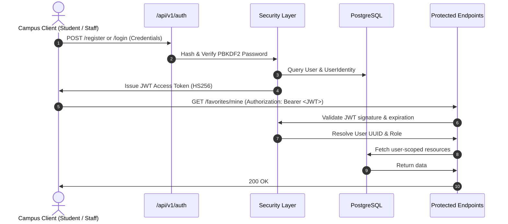

# CampusWay — Backend Architecture Specification

## 1. Executive Summary & Architectural Vision

CampusWay is a high-performance, modular geospatial navigation and route intelligence service built for Lovely Professional University (LPU), Punjab, India. The backend provides point-to-point shortest-path routing, topological pedestrian network traversal, hierarchical location cataloging, provenance-aware external map data ingestion, visitor wayfinding, and issue tracking.

The backend is built with Python 3.13, FastAPI, SQLAlchemy 2.0 ORM, Pydantic v2, PostgreSQL (including cloud Neon compatibility), and Alembic migrations.

---

## 2. System Architecture Diagram

```mermaid
graph TD
    subgraph Clients["Frontend Clients & Devices"]
        NextClient["Next.js Web Client"]
        MobileApp["Mobile / PWA Client"]
        Kiosk["Campus Wayfinding Kiosks"]
        QRScanner["Physical QR Readers"]
    end

    subgraph API_Gateway["FastAPI Application Layer (/api/v1)"]
        AuthRouter["/auth (JWT, Google SSO, Phone OTP)"]
        LocRouter["/locations (Hierarchical Catalog & Search)"]
        RouteRouter["/routing (Dijkstra, A*, Bearing Directions)"]
        ImportRouter["/import (GeoJSON & Staging Pipeline)"]
        AssistRouter["/assistance (Visitor Help & Signpost QR)"]
        FavRouter["/favorites (Bookmarked Destinations)"]
        RepRouter["/reports (Map Issue Reports & Review)"]
    end

    subgraph Security_Layer["Core Security & Dependencies"]
        JWTManager["Stateless JWT Token Validator (HS256)"]
        PBKDF2["PBKDF2-SHA256 Password Hasher"]
        RoleGuard["RBAC Guard (Visitor / User / Mod / Admin)"]
        DBScope["Scoped SQLAlchemy Session Lifecycle"]
    end

    subgraph Services_Domain["Service & Domain Logic Layer"]
        AuthService["AuthService (Identity & Provider Adapters)"]
        LocationService["LocationService (Search Ranking & Cycle Prevention)"]
        GraphService["GraphService (DB to In-Memory Topology)"]
        RoutingEngine["RoutingEngine (Dijkstra, A*, Step Directions)"]
        ImportService["ImportService (Provenance & Deduplication)"]
        AssistanceService["AssistanceService (Tamper-proof QR Tokens)"]
        ReportService["ReportService (Issue Moderation Workflow)"]
    end

    subgraph Persistence["Database Persistence Layer (PostgreSQL / Neon)"]
        DBUsers[("Users & Identities")]
        DBLocations[("Locations & Aliases")]
        DBGraph[("Navigation Nodes & Edges")]
        DBImport[("Import Batches & Staged Records")]
        DBAssistance[("Assistance Requests & QR Tokens")]
        DBReports[("Location Reports & Favorites")]
    end

    Clients --> API_Gateway
    API_Gateway --> Security_Layer
    Security_Layer --> Services_Domain
    Services_Domain --> Persistence
```



---

## 3. Layered Design & Module Decomposition

The backend enforces strict separation of concerns across distinct architectural layers:

```
backend/
├── app/
│   ├── api/                     # HTTP Transport Layer
│   │   ├── dependencies.py      # Dependency injection (Auth, DB, RBAC)
│   │   └── routes/              # Route handlers with OpenAPI documentation
│   │       ├── auth.py          # Session and credential endpoints
│   │       ├── locations.py     # Search, hierarchy, verification
│   │       ├── routing.py       # Graph vertices, edges, calculate route
│   │       ├── imports.py       # Staging batches, GeoJSON, admin review
│   │       ├── assistance.py    # Help requests, destination cards, QR
│   │       ├── favorites.py     # User bookmarks
│   │       └── reports.py       # Map problem reports & resolution
│   ├── core/                    # Core Cross-Cutting Concerns
│   │   ├── config.py            # Pydantic BaseSettings & environment configs
│   │   ├── database.py          # SQLAlchemy engine, session_scope, error handling
│   │   └── security.py          # PBKDF2 password hashing & JWT token management
│   ├── models/                  # SQLAlchemy ORM Database Entities
│   │   ├── user.py              # User & UserIdentity
│   │   ├── location.py          # Location & LocationAlias
│   │   ├── node.py              # Navigation Node (Vertex)
│   │   ├── edge.py              # Navigation Edge (Walkway)
│   │   ├── map_import.py        # MapImportBatch & StagedLocation
│   │   ├── report.py            # LocationReport
│   │   └── favorite.py          # Favorite
│   ├── schemas/                 # Pydantic v2 Request/Response Validation DTOs
│   │   ├── auth.py, user.py, location.py, graph.py, map_import.py, assistance.py, report.py, favorite.py
│   └── services/                # Pure Business & Domain Logic
│       ├── auth_service.py      # User lifecycle & identity reconciliation
│       ├── auth_providers.py    # Google OAuth and Phone OTP adapters
│       ├── location_service.py  # Ranking, alias matching, cycle prevention
│       ├── graph_service.py     # Graph database query & sync
│       ├── import_service.py    # External payload validation & duplicate detection
│       ├── assistance_service.py# HMAC-SHA256 signpost QR encoding/decoding
│       ├── report_service.py    # Map report lifecycle state machine
│       └── routing/             # Algorithmic Graph Engines
│           ├── algorithms.py    # Predecessor Dijkstra & A* with Haversine heuristic
│           ├── directions.py    # Bearing calculation & human turn instructions
│           └── graph.py         # In-memory CampusGraph topological structure
```

---

## 4. Key Architectural Patterns

### 4.1 Safe Session Management & Transaction Boundaries
The `get_db()` FastAPI dependency and `session_scope()` context manager ensure that all database operations execute inside an atomic unit of work:
- Explicit automatic commit on standard completion.
- Immediate rollback on unexpected exceptions.
- Session closed and connection returned to pool in `finally` blocks.

### 4.2 Predecessor-Backtracking Pathfinding
Rather than storing full path arrays in every priority queue entry (which leads to $O(V \cdot E)$ memory explosion on large graphs), the routing engine tracks parent node pointers via a predecessor dictionary:
- Priority queue stores only `(distance, current_node)`.
- Complexity is optimal: $O((V + E) \log V)$ time and $O(V)$ space.
- A* algorithm utilizes the Haversine great-circle distance divided by maximum pedestrian speed as an admissible heuristic.

### 4.3 Staging Pipeline for Map Provenance
To avoid polluting canonical campus data with unverified OpenStreetMap or GIS survey dumps, external records enter a dedicated staging area:
1. `MapImportBatch`: Tracks source provider, raw payload reference, timestamps, and aggregate stats.
2. `StagedLocation`: Preserves original external IDs, raw tags, and calculates proximity/name duplicate candidates against existing locations.
3. Review Step: Administrators approve (promoting record into `Location` with `is_verified=True`) or reject with structured reasons.

### 4.4 Tamper-Proof Signpost QR Token Architecture
Physical signpost QR codes encode HMAC-SHA256 signed tokens (`CWQR.<payload_b64>.<signature_b64>`):
- Self-contained and stateless: Can be resolved without exposing private database IDs.
- Topology verification: The resolver checks whether the scanned location or waypoint has verified walkable edges before promising navigation.
- Expiration and revocation guarantees.

---

## 5. Security & Authentication Model



### Roles and Privileges
- **`visitor`**: Public browsing, routing calculation, assistance request submission, QR scanning.
- **`user`**: Profile viewing, bookmark management, map issue reporting.
- **`moderator`**: Visitor assistance ticket assignment, map issue moderation.
- **`admin`**: Full write access to canonical locations, graph nodes, graph edges, import batch approval/rejection.

---

## 6. Known Constraints and External Dependencies

1. **Campus Ground-Truth Data**: The backend provides the full infrastructure and test fixtures. Actual LPU waypoint coordinates, building footprints, and corridor nodes will be supplied via the map import pipeline by the surveyor team.
2. **Third-Party Providers**: Google OAuth and Twilio/SMS OTP providers are implemented as extensible adapters with configuration validation and test mocks. Production deployment requires valid API keys in environment variables.
