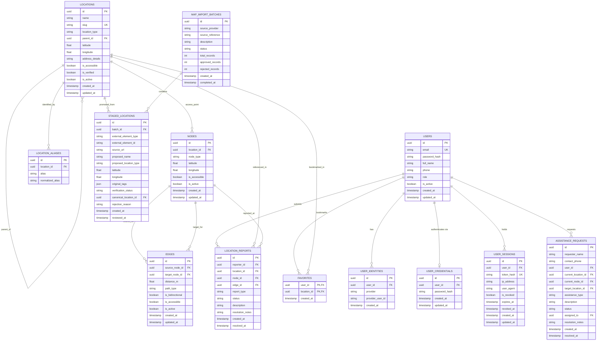

# CampusWay — Database Schema Specification

## 1. Overview
The CampusWay database is built on PostgreSQL with strict relational integrity, UUID primary keys, UTC timestamp auditing, and geospatial coordinates for campus wayfinding.

The schema is managed using **Alembic** migrations and is 100% compatible with both local PostgreSQL containers and Neon Cloud PostgreSQL.

---

## 2. Mermaid Entity-Relationship Diagram

---

## 3. Detailed Table Specifications

### 3.1 `users`
Core user identity for authentication, student/visitor sessions, and authorization.
- `id` (UUID, Primary Key, default `uuid4`)
- `email` (VARCHAR(255), Unique, Indexed, NOT NULL)
- `password_hash` (VARCHAR(255), NULL for OAuth-only users)
- `full_name` (VARCHAR(150), NULL)
- `phone` (VARCHAR(30), NULL)
- `role` (VARCHAR(50), NOT NULL, default `'user'`) — `'visitor'`, `'user'`, `'moderator'`, `'admin'`
- `is_active` (BOOLEAN, NOT NULL, default `TRUE`)
- `created_at` (TIMESTAMP WITH TIME ZONE, NOT NULL)
- `updated_at` (TIMESTAMP WITH TIME ZONE, NOT NULL)

### 3.2 `locations`
Campus points of interest, academic blocks, entrance gates, facilities, and rooms.
- `id` (UUID, Primary Key, default `uuid4`)
- `name` (VARCHAR(200), NOT NULL, Indexed)
- `slug` (VARCHAR(220), Unique, NOT NULL, Indexed)
- `location_type` (VARCHAR(50), NOT NULL, Indexed) — `'building'`, `'gate'`, `'room'`, `'landmark'`, `'facility'`, `'food_court'`
- `parent_id` (UUID, Foreign Key -> `locations.id`, ON DELETE SET NULL, NULL)
- `latitude` (DOUBLE PRECISION, NULL)
- `longitude` (DOUBLE PRECISION, NULL)
- `address_details` (TEXT, NULL)
- `is_accessible` (BOOLEAN, NOT NULL, default `TRUE`)
- `is_verified` (BOOLEAN, NOT NULL, default `FALSE`)
- `is_active` (BOOLEAN, NOT NULL, default `TRUE`)
- `created_at` (TIMESTAMP WITH TIME ZONE, NOT NULL)
- `updated_at` (TIMESTAMP WITH TIME ZONE, NOT NULL)

### 3.3 `nodes` (Routing Graph Vertices)
Navigational waypoints, road crossings, door access points, corridor intersections, and building gates.
- `id` (UUID, Primary Key, default `uuid4`)
- `location_id` (UUID, Foreign Key -> `locations.id`, ON DELETE SET NULL, NULL)
- `node_type` (VARCHAR(50), NOT NULL, default `'waypoint'`) — `'entrance'`, `'junction'`, `'corridor'`, `'gate'`, `'waypoint'`
- `latitude` (DOUBLE PRECISION, NOT NULL)
- `longitude` (DOUBLE PRECISION, NOT NULL)
- `is_accessible` (BOOLEAN, NOT NULL, default `TRUE`)
- `is_active` (BOOLEAN, NOT NULL, default `TRUE`)
- `created_at` (TIMESTAMP WITH TIME ZONE, NOT NULL)
- `updated_at` (TIMESTAMP WITH TIME ZONE, NOT NULL)

### 3.4 `edges` (Routing Graph Segments)
Walkable connections between nodes with metric distances and accessibility flags.
- `id` (UUID, Primary Key, default `uuid4`)
- `source_node_id` (UUID, Foreign Key -> `nodes.id`, ON DELETE CASCADE, NOT NULL)
- `target_node_id` (UUID, Foreign Key -> `nodes.id`, ON DELETE CASCADE, NOT NULL)
- `distance_m` (DOUBLE PRECISION, NOT NULL, CHECK `distance_m > 0`)
- `path_type` (VARCHAR(50), NOT NULL, default `'footpath'`) — `'footpath'`, `'corridor'`, `'staircase'`, `'ramp'`, `'road_crossing'`
- `is_bidirectional` (BOOLEAN, NOT NULL, default `TRUE`)
- `is_accessible` (BOOLEAN, NOT NULL, default `TRUE`)
- `is_active` (BOOLEAN, NOT NULL, default `TRUE`)
- `created_at` (TIMESTAMP WITH TIME ZONE, NOT NULL)
- `updated_at` (TIMESTAMP WITH TIME ZONE, NOT NULL)

### 3.5 `map_import_batches` & `staged_locations`
Provenance and staging pipeline for OpenStreetMap and surveyor GeoJSON data.
- Stores raw tags, external source URLs, verification state, and links to promoted canonical locations.

### 3.6 `assistance_requests`
Ticketing workflow for visitors and students needing wayfinding or mobility guidance.

---

## 4. Migration History & Alembic Chain

| Revision ID | Description | Created Tables / Columns |
| :--- | :--- | :--- |
| `001_initial_schema_v1` | Initial baseline schema | `users`, `user_identities`, `locations`, `location_aliases`, `nodes`, `edges`, `favorites`, `location_reports` |
| `002_map_import_provenance` | Map import pipeline & provenance | `map_import_batches`, `staged_locations` |
| `003_assistance_requests` | Visitor assistance & ticketing | `assistance_requests` |
| `004_report_resolution_notes` | Administrative report resolution | `location_reports.resolution_notes` column |

---

## 5. Shared Neon Cloud Database Safety Guidelines

1. **Zero Destructive Operations**: Never run `DROP TABLE`, `TRUNCATE`, or `alembic downgrade base` against shared cloud databases.
2. **Incremental Migrations Only**: All schema alterations must be scripted as additive, reversible Alembic revisions.
3. **Local Testing First**: Validate new migration revisions locally on an isolated test database (`pytest tests/test_migrations.py`) before applying to cloud instances.
