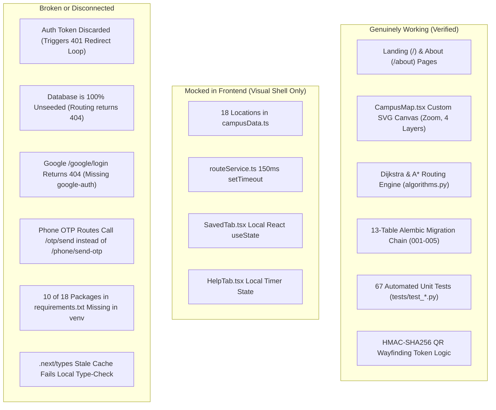
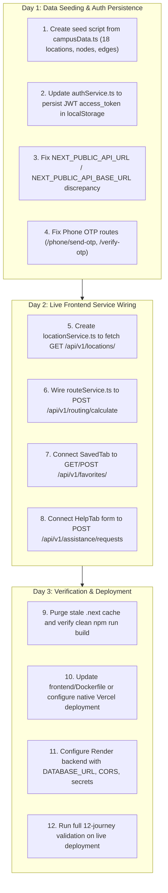

# CampusWay — Phase 0.1: Full-Stack Executive Audit Summary

**Project:** CampusWay — Intelligent Campus Navigation & Wayfinding Web Application  
**Target Submission Window:** 3 Days (Functional Demonstration MVP)  
**Branch:** `demo/submission-mvp` (Synchronized with `origin/demo/submission-mvp` at `138b7c4`)  
**Audit Completion Date:** November 10, 2026  
**Auditor:** Antigravity AI  
**Scope:** Full-Stack Source-Code Level Verification (Inspection-Only)  

---

## 1. Overall Repository Health & Assessment

| Subsystem | Readiness Score | Health Summary |
| :--- | :---: | :--- |
| **Backend Core** | **90%** | 41 active OpenAPI endpoints, complete Dijkstra & A* routing algorithms, QR signpost tokens, linear Alembic migrations (001-005), 67 passing unit tests in 3.05s. |
| **Frontend UI** | **85%** | High-fidelity Next.js 16.4.2 App Router interface, custom interactive SVG canvas map with 4 layers and zoom controls, glassmorphic auth cards, responsive mobile drawers. |
| **Full-Stack Integration** | **35%** | **Significant Gap.** The frontend operates primarily on an in-memory 18-location demonstration array and simulated delays. Five specific interface discrepancies prevent live communication. |
| **Database & Seed Data** | **40%** | Schema and migrations are 100% verified, but the live database contains **0 locations, 0 nodes, and 0 edges**. No seed script exists. |
| **Deployment Readiness**| **70%** | Docker Compose and Backend Dockerfile are production-ready. Frontend Dockerfile runs in development mode (`npm run dev`), local `.next` has stale types, and CORS defaults to localhost. |

---

## 2. High-Level Inventory: What Works, What is Mocked, What is Broken

---

## 3. Detailed Matrix of Findings

### A. What Genuinely Works (Verified by Source Code & Execution)
1. **Interactive SVG Vector Map ([`CampusMap.tsx`](file:///c:/Users/KK/Desktop/Projects/Campus%20Navigation/frontend/src/components/dashboard/CampusMap.tsx)):**
   - 4 selectable layer modes: *Campus Standard*, *CAD Blueprint*, *Satellite Tint*, and *Accessibility Ramps*.
   - Interactive zoom (+25% increments up to 2.0x, down to 0.75x) with Compass re-centering.
   - Interactive building footprints with tooltips and click-selection.
   - Animated SVG route polyline with pulsing glow stroke filter.
   - Floating route summary card (`~X min`, `X m`, `Step-free`).
   - **Zero dependency on Leaflet, Mapbox, or Google Maps.**
2. **Backend Routing & Pathfinding Engine ([`app/services/routing/`](file:///c:/Users/KK/Desktop/Projects/Campus%20Navigation/backend/app/services/routing/)):**
   - Dijkstra's algorithm with predecessor backtracking ($O((V+E)\log V)$ time, $O(V+E)$ space).
   - A* search using admissible Haversine spherical distance heuristic.
   - Directed vs. bidirectional edge traversal.
   - Walking duration calculation ($1.3\text{ m/s}$) and turn-by-turn guidance generator.
3. **Database Architecture & Migrations ([`database/migrations/versions/`](file:///c:/Users/KK/Desktop/Projects/Campus%20Navigation/database/migrations/versions)):**
   - Unified 13-table schema (`users`, `identities`, `credentials`, `sessions`, `locations`, `aliases`, `nodes`, `edges`, `favorites`, `reports`, `batches`, `staged`, `assistance`).
   - Strict linear revision chain (001 -> 005) with safe forward upgrades and clean rollbacks.
4. **Backend Test Suite ([`backend/tests/`](file:///c:/Users/KK/Desktop/Projects/Campus%20Navigation/backend/tests)):**
   - 67 tests passing in 3.05 seconds with in-memory SQLite isolation.
5. **QR Wayfinding Signposts ([`assistance_service.py`](file:///c:/Users/KK/Desktop/Projects/Campus%20Navigation/backend/app/services/assistance_service.py#L182-L260)):**
   - Tamper-proof HMAC-SHA256 signature generation and validation for physical signpost tokens.

---

### B. What Only Appears Implemented (Inferred / Disconnected)
1. **User Session Continuity:**
   - Frontend `LoginForm` posts credentials to the backend. The backend creates a JWT and returns `{ access_token, user }`.
   - However, the frontend discards the `access_token` and sets no cookie. When `AuthContext` calls `GET /api/v1/auth/me`, the backend rejects it with HTTP 401 Unauthorized, bouncing the user back to `/login`.
2. **Phone OTP Verification:**
   - Complete 2-step UI in [`PhoneOtpForm.tsx`](file:///c:/Users/KK/Desktop/Projects/Campus%20Navigation/frontend/src/components/auth/PhoneOtpForm.tsx), but calls `/api/v1/auth/otp/send` instead of `/api/v1/auth/phone/send-otp` (returns 404).
3. **Visitor Assistance Submission:**
   - Form in [`HelpTab.tsx`](file:///c:/Users/KK/Desktop/Projects/Campus%20Navigation/frontend/src/components/dashboard/HelpTab.tsx) displays a confirmation checkmark after 4 seconds, but never sends the ticket to `POST /api/v1/assistance/requests`.
4. **Saved Places:**
   - Bookmarking in [`SavedTab.tsx`](file:///c:/Users/KK/Desktop/Projects/Campus%20Navigation/frontend/src/components/dashboard/SavedTab.tsx) is held in transient React `useState`, disappearing on page reload.

---

### C. What is Mocked
1. **Campus Locations:** [`explore/page.tsx`](file:///c:/Users/KK/Desktop/Projects/Campus%20Navigation/frontend/src/app/explore/page.tsx) directly imports 18 hardcoded locations from [`campusData.ts`](file:///c:/Users/KK/Desktop/Projects/Campus%20Navigation/frontend/src/data/campusData.ts).
2. **Route Calculation:** [`routeService.ts`](file:///c:/Users/KK/Desktop/Projects/Campus%20Navigation/frontend/src/services/routeService.ts) returns synthetic waypoints from `generateDemonstrationRoute()` after a 150ms timeout.
3. **Initial Bookmarks:** Initialized to `["loc-block-34", "loc-library"]` in React memory.

---

### D. What is Broken
1. **`app.api.v1.auth` Router is Dead:**
   - Importing `app.api.v1.auth` fails with `ModuleNotFoundError: No module named 'google'` because `google-auth` is missing in `backend/venv`.
   - `main.py` silences this error with `except Exception: pass`, leaving `/auth/google/login` unmounted.
2. **Local TypeScript Type-Checking:**
   - `tsc --noEmit` fails with 24 errors because `frontend/.next/types/` has stale types from pre-restructure routes (`app/(public)/...`).
3. **API Base URL Configuration:**
   - `.env.example` instructs `NEXT_PUBLIC_API_URL`, but `authService.ts` checks `NEXT_PUBLIC_API_BASE_URL`.

---

### E. What is Missing
1. **Database Seed Script:** Zero seed files exist. `database/seeds/` contains only `.gitkeep`.
2. **Frontend `locationService.ts`:** No service exists to query `GET /api/v1/locations/` or `/api/v1/assistance/destinations`.
3. **QR Wayfinding Scanner UI:** Backend has token generate/resolve logic, but frontend lacks a camera/scanner modal.

---

## 4. Critical Blockers for the 3-Day Submission

1. **Empty Database Blocker:**
   If the database is not seeded with locations, nodes, and edges, any live connection between frontend and backend routing will return HTTP 404.
2. **Authentication Token Persistence Blocker:**
   Frontend must store the JWT `access_token` in `localStorage` and transmit it via `Authorization: Bearer <token>` (or backend must set the session cookie).
3. **Missing Virtualenv Packages Blocker:**
   `backend/venv` is missing 10 packages from `requirements.txt` (`google-auth`, `psycopg2-binary`, `asyncpg`, `pytest-asyncio`, etc.).
4. **Frontend Dockerfile Development Mode Blocker:**
   `frontend/Dockerfile` currently runs `CMD ["npm", "run", "dev"]`. Must be changed to production build if containerized on Render.
5. **CORS Origins Blocker:**
   Backend defaults `CORS_ORIGINS` to `localhost:3000`. Production deployment to Vercel requires adding the Vercel domain to `CORS_ORIGINS`.

---

## 5. Technical Debt & Risks

- **Competing Auth Routers:** The repository contains both `api/routes/auth.py` (stateless JWT, synchronous) and `api/v1/auth.py` (cookie session, async). For the 3-day MVP, the system should standardize on the working JWT router in `api/routes/auth.py`.
- **Scaffold Folders:** Empty root folders (`frontend/components/`, `frontend/hooks/`, `frontend/types/`) create confusion regarding where code lives.
- **Documentation Drift:** 5 documents contain contradictions (e.g., claiming Next.js 15, 27 tests, 8 tables, or non-existent routes).

---

## 6. Features to Reuse vs. Features to Postpone

### Reuse Without Rewriting (Core Strengths):
- **`CampusMap.tsx` SVG Vector Canvas:** Visually stunning, zero-dependency, and completely working.
- **Backend Routing Algorithms:** Dijkstra, A*, Haversine heuristic, walking time, turn directions.
- **Frontend Dashboard Components:** `DestinationPanel`, `Sidebar`, `Topbar`, `RoutesTab`, `SavedTab`, `HelpTab`.
- **The 18-Location Dataset in `campusData.ts`:** Convert directly into the canonical database seed script!

### Postpone Beyond 3-Day Submission:
- Live Google OAuth credentials and Twilio SMS keys (rely on email/password and mock OTP).
- Camera QR barcode scanning (demonstrate QR wayfinding via URL query params like `?qr=CWQR...`).
- Admin map import pipeline UI (GeoJSON staging pipeline is backend-tested, but not required for visitor MVP demo).

---

## 7. Realistic 3-Day Prioritized Implementation Sequence

---

## 8. Summary of Audit Deliverables Created

All five mandated audit reports plus the documentation audit have been generated in `docs/`:
1. [`docs/MVP_PHASE_0_1_FRONTEND_AUDIT.md`](file:///c:/Users/KK/Desktop/Projects/Campus%20Navigation/docs/MVP_PHASE_0_1_FRONTEND_AUDIT.md) — Comprehensive Next.js component, page, and service audit.
2. [`docs/MVP_PHASE_0_1_BACKEND_AUDIT.md`](file:///c:/Users/KK/Desktop/Projects/Campus%20Navigation/docs/MVP_PHASE_0_1_BACKEND_AUDIT.md) — 41-endpoint audit, dependency gap analysis, routing engine verification.
3. [`docs/MVP_PHASE_0_1_INTEGRATION_AUDIT.md`](file:///c:/Users/KK/Desktop/Projects/Campus%20Navigation/docs/MVP_PHASE_0_1_INTEGRATION_AUDIT.md) — 12 end-to-end user journeys traced, 5 interface discrepancies identified.
4. [`docs/MVP_PHASE_0_1_DATABASE_AND_DEPLOYMENT_AUDIT.md`](file:///c:/Users/KK/Desktop/Projects/Campus%20Navigation/docs/MVP_PHASE_0_1_DATABASE_AND_DEPLOYMENT_AUDIT.md) — Seed data gap analysis, Docker inspection, Render & Vercel deployment rules.
5. [`docs/MVP_PHASE_0_1_DOCUMENTATION_AUDIT.md`](file:///c:/Users/KK/Desktop/Projects/Campus%20Navigation/docs/MVP_PHASE_0_1_DOCUMENTATION_AUDIT.md) — 16-document inventory, classification matrix, contradiction cross-checks.
6. [`docs/MVP_PHASE_0_1_EXECUTIVE_SUMMARY.md`](file:///c:/Users/KK/Desktop/Projects/Campus%20Navigation/docs/MVP_PHASE_0_1_EXECUTIVE_SUMMARY.md) — This master synthesis.

*(In compliance with the audit mandate, zero application code was modified, zero migrations were run, and zero files were moved or deleted. The system is ready for review.)*

