# CampusWay — Phase 0.1: Frontend Source-Code Audit

**Target Directory:** `frontend/`  
**Framework:** Next.js 16.4.2 (App Router), React 19.3.0, TypeScript 5, Tailwind CSS v4  
**Audit Date:** November 10, 2026  
**Auditor:** Antigravity AI  
**Scope:** Source-code level inspection (Inspection-Only, Zero Code Changes)  

---

## 1. Architecture, Directory Structure & Code Organization

### 1.1 Structural Duality: Active Code vs. Empty Scaffolding
The repository exhibits a structural duality resulting from an earlier project restructuring:
- **Active Operational Application:** Resides strictly within [`frontend/src/`](file:///c:/Users/KK/Desktop/Projects/Campus%20Navigation/frontend/src).
- **Obsolete Root Scaffolding:** A set of empty skeleton directories exists at the `frontend/` root, containing only `.gitkeep` files:
  - `frontend/components/` (`layout/`, `locations/`, `map/`, `navigation/`, `ui/`) — all empty `.gitkeep`.
  - `frontend/hooks/` — empty `.gitkeep`.
  - `frontend/public/assets/` — empty `.gitkeep`.
  - `frontend/lib/api/client.ts` — 7-line file defining `API_BASE_URL`.
  - `frontend/lib/utils/cn.ts` — `clsx` / `tailwind-merge` helper.
  - `frontend/types/index.ts` — 148-line TypeScript file defining backend-aligned data contracts (`User`, `CampusLocation`, `NavigationNode`, `WalkableEdge`, `RouteResponse`), completely unreferenced by the active `src/` UI.

### 1.2 Path Aliasing & Module Resolution
In [`frontend/tsconfig.json`](file:///c:/Users/KK/Desktop/Projects/Campus%20Navigation/frontend/tsconfig.json#L25-L29), path resolution is configured as:
```json
"paths": {
  "@/*": ["./src/*"]
}
```
All active components, services, and hooks import exclusively via `@/...`, resolving to `frontend/src/`. None of the active components import from the root `frontend/components/`, `frontend/hooks/`, or `frontend/types/index.ts`.

### 1.3 Active Component Dependency Graph

```mermaid
graph TD
    RootLayout["src/app/layout.tsx"] --> AuthProvider["src/context/AuthContext.tsx"]
    AuthProvider --> Navbar["src/components/layout/Navbar.tsx"]
    
    subgraph Pages
        HomePage["src/app/page.tsx"] --> HeroCta["src/components/home/HeroCta.tsx"]
        AboutPage["src/app/about/page.tsx"]
        LoginPage["src/app/login/page.tsx"] --> LoginForm["src/components/auth/LoginForm.tsx"]
        SignupPage["src/app/signup/page.tsx"] --> SignupForm["src/components/auth/SignupForm.tsx"]
        ExplorePage["src/app/explore/page.tsx"] --> DashboardGroup["Dashboard Core"]
    end
    
    LoginForm --> GoogleButton["src/components/auth/GoogleButton.tsx"]
    LoginForm --> PhoneOtpForm["src/components/auth/PhoneOtpForm.tsx"]
    LoginForm --> AuthCard["src/components/auth/AuthCard.tsx"]
    SignupForm --> AuthCard
    
    subgraph DashboardGroup["Dashboard Core (src/components/dashboard/)"]
        Sidebar["Sidebar.tsx"]
        Topbar["Topbar.tsx"]
        CampusMap["CampusMap.tsx"]
        DestPanel["DestinationPanel.tsx"]
        RoutesTab["RoutesTab.tsx"]
        SavedTab["SavedTab.tsx"]
        HelpTab["HelpTab.tsx"]
        DashIcons["DashboardIcons.tsx"]
    end
    
    ExplorePage --> CampusMap
    ExplorePage --> DestPanel
    ExplorePage --> Sidebar
    ExplorePage --> Topbar
    ExplorePage --> RoutesTab
    ExplorePage --> SavedTab
    ExplorePage --> HelpTab
    
    LoginForm --> AuthService["src/services/authService.ts"]
    SignupForm --> AuthService
    ExplorePage --> RouteService["src/services/routeService.ts"]
    ExplorePage --> CampusData["src/data/campusData.ts"]
    RouteService --> CampusData
```


---

## 2. Page-by-Page Source-Code Audit

### 2.1 Landing Page ([`frontend/src/app/page.tsx`](file:///c:/Users/KK/Desktop/Projects/Campus%20Navigation/frontend/src/app/page.tsx))
- **Implementation Status:** **Complete UI / Static Presentation.**
- **Components Used:** [`Navbar`](file:///c:/Users/KK/Desktop/Projects/Campus%20Navigation/frontend/src/components/layout/Navbar.tsx), [`HeroCta`](file:///c:/Users/KK/Desktop/Projects/Campus%20Navigation/frontend/src/components/home/HeroCta.tsx), Next.js `Image`.
- **Backend Connectivity:** None. Purely static presentation.
- **Interactions & State:**
  - Hero photography (`/images/campus-bg.jpg`) with dark contrast overlay.
  - "Find your place. Navigate with confidence." typography.
  - CTAs: "Explore Campus Map" (links to `/explore`), "Find a Building" (links to `/explore?focus=search`), "Sign In" (links to `/login`).
  - Three feature teasers: 01 Campus Map Service, 02 Route Planning Service, 03 Visitor Assistance.
- **Gaps / Incompleteness:** Fully functional presentation page with zero defects.

---

### 2.2 About Page ([`frontend/src/app/about/page.tsx`](file:///c:/Users/KK/Desktop/Projects/Campus%20Navigation/frontend/src/app/about/page.tsx))
- **Implementation Status:** **Complete UI / Static Presentation.**
- **Components Used:** [`Navbar`](file:///c:/Users/KK/Desktop/Projects/Campus%20Navigation/frontend/src/components/layout/Navbar.tsx), Next.js `Image`, Next.js `Link`.
- **Backend Connectivity:** None.
- **Interactions & State:**
  - Glassmorphic card detailing project goals, target audience, architectural stack breakdown (Next.js, FastAPI, PostgreSQL, JWT/Google OAuth).
  - Navigation CTAs back to `/` and `/login`.
- **Gaps / Incompleteness:** None. Production-ready presentation.

---

### 2.3 Sign-In Page ([`frontend/src/app/login/page.tsx`](file:///c:/Users/KK/Desktop/Projects/Campus%20Navigation/frontend/src/app/login/page.tsx))
- **Implementation Status:** **Functional UI with Partial Backend Integration.**
- **Components Used:** [`AuthCard`](file:///c:/Users/KK/Desktop/Projects/Campus%20Navigation/frontend/src/components/auth/AuthCard.tsx), [`LoginForm`](file:///c:/Users/KK/Desktop/Projects/Campus%20Navigation/frontend/src/components/auth/LoginForm.tsx), [`CampusBranding`](file:///c:/Users/KK/Desktop/Projects/Campus%20Navigation/frontend/src/components/layout/CampusBranding.tsx), [`Navbar`](file:///c:/Users/KK/Desktop/Projects/Campus%20Navigation/frontend/src/components/layout/Navbar.tsx).
- **Backend Connectivity:**
  - Calls `authService.login()` targeting `POST /api/v1/auth/login`.
  - Checks pre-flight `authService.checkBackendHealth()` targeting `GET /api/v1/health`.
  - Reads URL query parameters (`?error=session_required`, `?error=google_not_configured`, `?notice=logged_out`).
- **Detailed Form Modes in `LoginForm.tsx`:**
  1. *Email/Password Tab:*
     - Fields: Email, Password, Remember Me checkbox.
     - Password visibility toggle (`EyeIcon` / `EyeOffIcon`).
     - Client validation: Email regex, non-empty password.
     - On submit: Calls `authService.login({ email, password, rememberMe })`. If backend returns success, calls `refreshUser()` from `AuthContext` and redirects to `/explore`.
     - Error state: Renders red error alert box with `errorData.detail`.
  2. *Forgot Password Sub-view:*
     - Toggles inside the card without page reload.
     - Input for email address. Simulated notice: *"Password reset instructions have been dispatched if this email exists."*
  3. *Phone Number Tab:*
     - Renders [`PhoneOtpForm`](file:///c:/Users/KK/Desktop/Projects/Campus%20Navigation/frontend/src/components/auth/PhoneOtpForm.tsx) for SMS OTP.
  4. *Google OAuth Button:*
     - Renders [`GoogleButton`](file:///c:/Users/KK/Desktop/Projects/Campus%20Navigation/frontend/src/components/auth/GoogleButton.tsx).
- **Identified Defects & Contract Mismatches:**
  - *Contract Mismatch:* The backend's `/api/v1/auth/login` returns `{ access_token, token_type, expires_in_seconds, user }` (stateless JWT Bearer token), but the frontend `LoginForm` does not persist `access_token` in `localStorage` or `sessionStorage`. Instead, it assumes the backend sets an HTTP-only session cookie (`credentials: "include"`).
  - *Redirect to Broken Google Endpoint:* `GoogleButton.tsx` redirects browser to `authService.getGoogleLoginUrl()` (`/api/v1/auth/google/login`), which returns 404 on the backend because `app.api.v1.auth` failed to mount (due to missing `google-auth` library) and the canonical endpoint in `app.api.routes.auth` is `POST /api/v1/auth/google` expecting an ID token.

---

### 2.4 Registration Page ([`frontend/src/app/signup/page.tsx`](file:///c:/Users/KK/Desktop/Projects/Campus%20Navigation/frontend/src/app/signup/page.tsx))
- **Implementation Status:** **Functional UI with Partial Backend Integration.**
- **Components Used:** [`AuthCard`](file:///c:/Users/KK/Desktop/Projects/Campus%20Navigation/frontend/src/components/auth/AuthCard.tsx), [`SignupForm`](file:///c:/Users/KK/Desktop/Projects/Campus%20Navigation/frontend/src/components/auth/SignupForm.tsx).
- **Backend Connectivity:** Calls `authService.signup()` targeting `POST /api/v1/auth/register`.
- **Form Validation & State:**
  - Fields: Full Name, Email, Password, Confirm Password.
  - Client-side checks: Name min 2 chars, valid email format, password min 8 chars with uppercase, lowercase, number, and matching confirm password.
  - Success behavior: Calls `refreshUser()` and redirects to `/explore`.
- **Identified Defects & Contract Mismatches:**
  - Same token persistence mismatch: Backend returns `{ access_token, user }`, frontend expects automatic cookie attachment.

---

### 2.5 Explore Dashboard ([`frontend/src/app/explore/page.tsx`](file:///c:/Users/KK/Desktop/Projects/Campus%20Navigation/frontend/src/app/explore/page.tsx))
- **Implementation Status:** **Functional Interactive Prototype relying on Mock Data.**
- **Components Used:** [`CampusMap`](file:///c:/Users/KK/Desktop/Projects/Campus%20Navigation/frontend/src/components/dashboard/CampusMap.tsx), [`Sidebar`](file:///c:/Users/KK/Desktop/Projects/Campus%20Navigation/frontend/src/components/dashboard/Sidebar.tsx), [`Topbar`](file:///c:/Users/KK/Desktop/Projects/Campus%20Navigation/frontend/src/components/dashboard/Topbar.tsx), [`DestinationPanel`](file:///c:/Users/KK/Desktop/Projects/Campus%20Navigation/frontend/src/components/dashboard/DestinationPanel.tsx), [`RoutesTab`](file:///c:/Users/KK/Desktop/Projects/Campus%20Navigation/frontend/src/components/dashboard/RoutesTab.tsx), [`SavedTab`](file:///c:/Users/KK/Desktop/Projects/Campus%20Navigation/frontend/src/components/dashboard/SavedTab.tsx), [`HelpTab`](file:///c:/Users/KK/Desktop/Projects/Campus%20Navigation/frontend/src/components/dashboard/HelpTab.tsx).
- **Backend Connectivity:** **ZERO live backend calls.**
  - Guarded by `AuthContext.tsx`. If `user === null`, redirects to `/login?error=session_required`.
  - Locations are loaded from `SAMPLE_LOCATIONS` in [`frontend/src/data/campusData.ts`](file:///c:/Users/KK/Desktop/Projects/Campus%20Navigation/frontend/src/data/campusData.ts).
  - Routes are calculated by `routeService.calculateRoute()` which calls `generateDemonstrationRoute()` with an artificial 150ms timeout.
  - Saved places are stored in local React state (`useState<string[]>(["loc-block-34", "loc-library"])`), resetting upon page refresh.
  - Visitor assistance tickets submitted in `HelpTab` set a 4-second timeout without calling `POST /api/v1/assistance/requests`.

---

## 3. Component-Level Source-Code Audit

### 3.1 CampusMap ([`frontend/src/components/dashboard/CampusMap.tsx`](file:///c:/Users/KK/Desktop/Projects/Campus%20Navigation/frontend/src/components/dashboard/CampusMap.tsx))
- **Lines of Code:** 477 lines.
- **Rendering Technology:** Pure SVG Vector Canvas (`viewBox="0 0 1000 700"`).
- **Features Implemented:**
  1. *View Controls:*
     - Zoom In button (+0.25 scaling up to 2.0x).
     - Zoom Out button (-0.25 scaling down to 0.75x).
     - Reset View / Compass button (resets zoom to 1.0x).
  2. *Layer Switcher Dropdown:*
     - `standard`: Ground gradient, lawns, trees, roads, pedestrian boulevards.
     - `blueprint`: Dark architectural CAD grid pattern (`<pattern id="blueprintGrid">`).
     - `satellite`: Muted dark satellite imagery tint.
     - `accessibility`: Highlights wheelchair ramps and barrier-free routes in high-contrast cyan/emerald.
  3. *Building Footprints & Interaction:*
     - Renders building geometries (`rect`, `circle`, `path`) using `loc.buildingShape` coordinates.
     - Interactive SVG `<g>` elements with hover stroke, cursor pointer, tooltip card, and click callback `onSelectLocation(loc)`.
  4. *Route Path Overlay:*
     - Constructs SVG path string `routePathD` from `activeRoute.waypoints` (`M x y L x y ...`).
     - Renders glowing drop-shadow filter (`<filter id="routeGlow">`) with animated pulsing dashed stroke (`strokeDasharray="8 6"`).
  5. *Route Summary Banner:*
     - Floating pill at top-left displaying destination name, origin name, estimated walking time (`~X min`), metric distance (`X m`), and step-free walkway indicator.
- **Assessment:** Exceptionally well-crafted, lightweight, and fully functional vector map. Does not require Leaflet or Mapbox for the 3-day MVP demonstration.

---

### 3.2 DestinationPanel ([`frontend/src/components/dashboard/DestinationPanel.tsx`](file:///c:/Users/KK/Desktop/Projects/Campus%20Navigation/frontend/src/components/dashboard/DestinationPanel.tsx))
- **Lines of Code:** 306 lines.
- **Features Implemented:**
  - Search input filtering locations by name, code, description, departments, and facilities.
  - Category filter pills: `All`, `Buildings`, `Rooms`, `Landmarks`.
  - Selected Location Hero Card: Category badge, location code, operating hours, floor details, department tags, facility pills, accessibility description.
  - Action buttons:
    - *"Get Directions"* / *"Preview Route"*: Toggles active route on map.
    - Bookmark button: Toggles local saved state with 3-second toast notice.
  - Filtered Location List: Clickable cards to switch selected building/room.
- **Assessment:** High-fidelity UI. Needs connection to backend `GET /api/v1/locations/` and `POST /api/v1/favorites/`.

---

### 3.3 RoutesTab ([`frontend/src/components/dashboard/RoutesTab.tsx`](file:///c:/Users/KK/Desktop/Projects/Campus%20Navigation/frontend/src/components/dashboard/RoutesTab.tsx))
- **Lines of Code:** 120 lines.
- **Features Implemented:**
  - Route header showing origin (default: Main Gate), destination, total distance, and duration.
  - Step-by-step turn guidance list (`RouteStep[]`):
    - Direction indicators (straight, right, left, enter).
    - Step instruction text and incremental metric distances.
  - Accessibility notice ("100% barrier-free route").
- **Assessment:** Works seamlessly with `CampusRoute` objects. Ready to consume live backend `RouteResponse` segments.

---

### 3.4 SavedTab ([`frontend/src/components/dashboard/SavedTab.tsx`](file:///c:/Users/KK/Desktop/Projects/Campus%20Navigation/frontend/src/components/dashboard/SavedTab.tsx))
- **Lines of Code:** 92 lines.
- **Features Implemented:**
  - Displays grid of bookmarked location cards.
  - Buttons: *"View on Map"* (switches tab to Explore and selects location), *"Remove"* (unbookmarks location).
  - Empty state when `savedLocations.length === 0`.
- **Assessment:** Functional in React memory, but disconnected from backend `GET /api/v1/favorites/mine`.

---

### 3.5 HelpTab ([`frontend/src/components/dashboard/HelpTab.tsx`](file:///c:/Users/KK/Desktop/Projects/Campus%20Navigation/frontend/src/components/dashboard/HelpTab.tsx))
- **Lines of Code:** 134 lines.
- **Features Implemented:**
  - Essential Contacts directory: Campus Security (Main Gate), Student Medical Center, Disability Support, Shuttle Dispatch.
  - FAQ Accordion: 3 common wayfinding questions and answers.
  - "Request Navigation Assistance" ticket submission form: Textarea with submit button.
- **Assessment:** Form submission is simulated with `setTimeout` (`ticketSent = true`). Disconnected from `POST /api/v1/assistance/requests`.

---

### 3.6 PhoneOtpForm ([`frontend/src/components/auth/PhoneOtpForm.tsx`](file:///c:/Users/KK/Desktop/Projects/Campus%20Navigation/frontend/src/components/auth/PhoneOtpForm.tsx))
- **Lines of Code:** 350 lines.
- **Features Implemented:**
  - Step 1 (Phone Input): Country code selector (+91 India, +1 US, +44 UK, etc.), mobile number input, "Send Verification Code" CTA.
  - Step 2 (Code Verification): 6-digit PIN input with auto-focus shifting across boxes, 60-second resend countdown timer, "Verify & Continue" CTA.
- **Defects & Mismatches:**
  - Calls `authService.requestPhoneOtp()` which requests `/api/v1/auth/otp/send` -> **Backend route is `/api/v1/auth/phone/send-otp`** (Returns 404).
  - Calls `authService.verifyPhoneOtp()` which requests `/api/v1/auth/otp/verify` -> **Backend route is `/api/v1/auth/phone/verify-otp`** (Returns 404).

---

## 4. Frontend Service Integration & API Contract Audit

### 4.1 Environment Variable Mismatch
- In [`frontend/.env.example`](file:///c:/Users/KK/Desktop/Projects/Campus%20Navigation/frontend/.env.example) and [`docker-compose.yml`](file:///c:/Users/KK/Desktop/Projects/Campus%20Navigation/docker-compose.yml):
  `NEXT_PUBLIC_API_URL=http://localhost:8000`
- In [`frontend/src/services/authService.ts`](file:///c:/Users/KK/Desktop/Projects/Campus%20Navigation/frontend/src/services/authService.ts#L17-L18):
  `const API_BASE_URL = process.env.NEXT_PUBLIC_API_BASE_URL || "http://localhost:8000";`
- **Result:** If a developer sets `NEXT_PUBLIC_API_URL` as instructed in `.env.example`, `authService.ts` ignores it and falls back to `http://localhost:8000`.

### 4.2 Endpoint Contract Audit Table

| Frontend Call | Frontend Target URL | Actual Backend Route | Status | Issue / Discrepancy |
| :--- | :--- | :--- | :---: | :--- |
| `authService.login` | `POST /api/v1/auth/login` | `POST /api/v1/auth/login` | **Partial** | Backend returns `{ access_token }`; frontend stores no token, relying on unconfigured cookies. |
| `authService.signup` | `POST /api/v1/auth/register` | `POST /api/v1/auth/register` | **Partial** | Backend returns `{ access_token }`; frontend stores no token. |
| `authService.getCurrentUser` | `GET /api/v1/auth/me` | `GET /api/v1/auth/me` | **Broken** | Backend expects `Authorization: Bearer <token>`; frontend sends only cookies (`credentials: "include"`). Returns 401 Unauthorized. |
| `authService.logout` | `POST /api/v1/auth/logout` | `POST /api/v1/auth/logout` | **Functional** | Discards session. |
| `authService.requestPhoneOtp` | `POST /api/v1/auth/otp/send` | `POST /api/v1/auth/phone/send-otp` | **Broken** | 404 Not Found (Path mismatch). |
| `authService.verifyPhoneOtp` | `POST /api/v1/auth/otp/verify` | `POST /api/v1/auth/phone/verify-otp` | **Broken** | 404 Not Found (Path mismatch). |
| `authService.getGoogleLoginUrl` | `GET /api/v1/auth/google/login` | *None* | **Broken** | 404 Not Found. Backend `api/v1/auth.py` was never mounted due to missing `google-auth` package. |
| `routeService.calculateRoute` | *None (Local mock)* | `POST /api/v1/routing/calculate` | **Mocked** | Never calls backend. Returns hardcoded synthetic waypoints. |
| Locations Fetch | *None (Local mock)* | `GET /api/v1/locations/` | **Mocked** | Dashboard uses hardcoded `SAMPLE_LOCATIONS` array. |
| Favorites Sync | *None (Local state)* | `GET /api/v1/favorites/mine` | **Mocked** | Saved tab state is transient in memory. |
| Help Request | *None (Local state)* | `POST /api/v1/assistance/requests` | **Mocked** | Form submission is simulated with timer. |

---

## 5. Frontend Quality, Build & Dependency Checks

### 5.1 TypeScript Compilation Status
Executing `npm --prefix frontend run type-check` (`tsc --noEmit`) outputs **24 compilation errors**:
```text
.next/types/app/(public)/explore/page.ts(2,24): error TS2307: Cannot find module '../../../../../app/(public)/explore/page.js'
.next/types/app/(public)/help/page.ts(2,24): error TS2307: Cannot find module '../../../../../app/(public)/help/page.js'
.next/types/app/(public)/locations/[locationId]/page.ts(2,24): error TS2307: Cannot find module '../../../../../../app/(public)/locations/[locationId]/page.js'
.next/types/app/(public)/navigate/page.ts(2,24): error TS2307: Cannot find module '../../../../../app/(public)/navigate/page.js'
.next/types/app/admin/dashboard/page.ts(2,24): error TS2307: Cannot find module '../../../../../app/admin/dashboard/page.js'
```
- **Root Cause:** The checked-in or cached `frontend/.next/types/` contains stale artifacts from an earlier project layout (`app/(public)/...`).
- **Source Code Health:** The actual TypeScript code in `frontend/src/` has **zero syntax or typing errors**. When `.next` is cleaned before build, Next.js generates fresh types matching `src/app/` without error.

### 5.2 Dependency Health
- Zero unneeded third-party libraries installed in `frontend/package.json`.
- Next.js 16.4.2 and React 19.3.0 are installed and operational.
- Tailwind CSS v4 is configured properly via `@import "tailwindcss";`.

