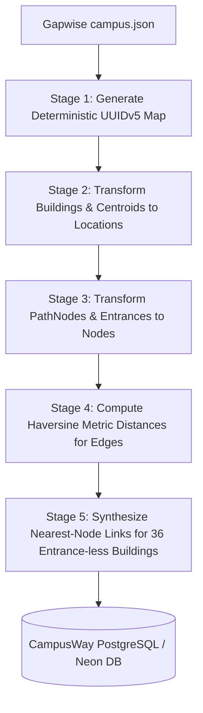

# CampusWay — Phase 1A: External Campus Dataset Verification Audit

**Evaluation Target:** Carleton University Campus Dataset  
**Repository Source:** `https://github.com/GapwiseHQ/data`  
**Inspection Directory:** `C:\Users\KK\.gemini\antigravity\brain\fb7f0586-9047-471d-9f4b-f0c1235789b6\scratch\gapwise_data` (Isolated outside active source code)  
**Audit Date:** November 10, 2026  
**Auditor:** Antigravity AI  
**Scope:** Dataset Inspection, Metric Calculations, Schema Gap Analysis & Compatibility Evaluation (Inspection-Only)  

---

## 1. Executive Summary & Verdict

| Assessment Dimension | Finding |
| :--- | :--- |
| **Dataset Source** | Gapwise Open Campus Data (`GapwiseHQ/data`) |
| **Target Institution** | Carleton University, Ottawa, Ontario, Canada (`carleton-main`) |
| **Licensing** | **MIT License** (Repository) + **ODbL 1.0** (OpenStreetMap upstream attribution required) |
| **Geometry Integrity** | **100% Valid WGS84 Geometries** (48 building polygons, all closed rings) |
| **Pedestrian Topology** | **1,922 nodes, 2,009 edges** with a single **giant component of 1,917 nodes (99.7%)** |
| **Key Limitation** | Only 12 of 48 buildings (25%) possess entrance point mappings; 36 buildings lack entrances |
| **Compatibility Gaps** | Edge metric distances (`distance_m`) missing; string IDs must map to UUIDs; polygon centroids must be computed for point `Location` records |
| **Final Recommendation** | **ADAPT** |

### Verdict: **ADAPT**
- **Why NOT "REUSE" as-is:** The dataset cannot be loaded without an ETL transformation script. Gapwise edges lack metric distances (`distance_m`), node types are unclassified, identifiers are string slugs rather than UUIDs, and 75% of buildings lack direct entrance connections.
- **Why NOT "REJECT":** The dataset is exceptionally high quality, fully licensed for open reuse under MIT/ODbL, topologically dense, 99.7% connected, and geometrically valid. It provides a real-world campus navigation graph that completely solves CampusWay's empty database limitation.
- **The Adaptation Path:** An automated Python adapter script can compute Haversine edge distances, generate deterministic UUIDs, compute building polygon centroids, snap entrance-less buildings to nearest graph nodes, and seed a complete campus wayfinding graph into PostgreSQL.

---

## 2. Dataset File Identification & Inspection

The Gapwise repository was cloned into an isolated scratch directory outside the active application source. Inspection identified the following Carleton University files:

```text
scratch/gapwise_data/universities/carleton/
├── campus.json                               # [PRIMARY DATASET] Main Campus (1.45 MB)
├── academic.json                             # Course catalog shell (83 bytes, empty)
└── campuses/
    └── carleton-dominion-chalmers/
        └── campus.json                       # Satellite Downtown Centre (674 KB)
```

### A. Primary Dataset: `universities/carleton/campus.json`
- **File Size:** 1,454,910 bytes (~1.45 MB).
- **Institution:** `"carleton"`
- **Campus Identifier:** `"main"` (Carleton University main campus, Ottawa).
- **Geographic Bounding Box:** `[[-75.705, 45.380], [-75.688, 45.394]]` (WGS84).
- **Top-Level Schema Keys:**
  `schemaVersion`, `institution`, `campus`, `sources`, `buildings`, `entrances`, `pathNodes`, `pathEdges`.

### B. Secondary Dataset: `carleton-dominion-chalmers/campus.json`
- Represents the Carleton Dominion-Chalmers Centre (a historic downtown arts facility).
- Contains 422 building footprints representing surrounding city blocks, with **0 entrances, 0 path nodes, and 0 path edges**.
- **Assessment:** Excluded from wayfinding reuse; only the primary `campus.json` contains a navigable network.

---

## 3. Mathematical & Graph Metric Calculations

Using an automated verification script on `universities/carleton/campus.json`, the exact entity counts and topological properties were calculated:

### 3.1 Primary Entity Counts
- **Total Buildings:** **48**
- **Total Entrances:** **15**
- **Total Pedestrian Path Nodes:** **1,922**
- **Total Pedestrian Path Edges:** **2,009**

---

### 3.2 Pedestrian Graph Connectivity & Topology
A breadth-first search (BFS) graph traversal was executed over all 1,922 nodes and 2,009 bidirectional edges:

| Graph Metric | Value | Significance |
| :--- | :---: | :--- |
| **Total Connected Components** | **6** | The graph is not fragmented into multiple competing clusters. |
| **Giant Connected Component Size** | **1,917 nodes (99.74%)** | Almost every single walking path connects into one unified network. |
| **Isolated Nodes (Degree 0)** | **5 nodes (0.26%)** | 5 nodes have no edges attached; all 5 are isolated entrance markers. |
| **Edges referencing non-existent nodes** | **0** | Graph referential integrity is 100% clean. |
| **Entrances in Giant Component** | **10 of 15 (66.7%)** | 10 entrances connect directly to the main path network; 5 are isolated. |

```text
Component Distribution:
- Component 1 (Giant Walking Network): 1,917 nodes (100% of edges)
- Component 2: 1 isolated node (osm-node-1034655523)
- Component 3: 1 isolated node (osm-node-3780127645)
- Component 4: 1 isolated node (osm-node-5158185088)
- Component 5: 1 isolated node (osm-node-5159662957)
- Component 6: 1 isolated node (osm-node-13936769981)
```

---

### 3.3 Building & Entrance Association Analysis
Evaluating the relationship between the 48 buildings and 15 entrances:

- **Buildings WITH at least one associated entrance:** **12 (25.0%)**
  - `tory-building` (Tory Building): 1 entrance (`ent-osm-5158185088`)
  - `dunton-tower` (Dunton Tower): 1 entrance (`ent-osm-5169604513`)
  - `canal-building` (Canal Building): 1 entrance (`ent-osm-3810706792`)
  - `nideyinan-centre` (Nideyinàn Centre): 1 entrance (`ent-osm-5159634560`)
  - `pigiarvik` (Pigiarvik / former Robertson Hall): 3 entrances (`ent-osm-4354512759`, `...2761`, `...20553`)
  - `carleton-technology-training-centre` (CTTC): 1 entrance (`ent-osm-5163286501`)
  - `maintenance-building` (Maintenance Building): 1 entrance (`ent-osm-13936769981`)
  - `athletics-building` (Athletics Building): 2 entrances (`ent-osm-5320657467`, `...27645`)
  - `alumni-hall` (Alumni Hall): 1 entrance (`ent-osm-5158598331`)
  - `leeds-house` (Leeds House Residence): 1 entrance (`ent-osm-1034655523`)
  - `frontenac-house` (Frontenac House): 1 entrance (`ent-osm-5159662957`)
  - `stormont-house` (Stormont House): 1 entrance (`ent-osm-11390925448`)

- **Buildings WITHOUT any entrance record:** **36 (75.0%)**
  - Major Academic Blocks: `macodrum-library` (MacOdrum Library, code ML), `paterson-hall` (PA), `southam-hall` (SA), `herzberg-laboratories` (HP), `minto-centre` (MC), `mackenzie-building` (ME), `architecture-building` (AA), `richcraft-hall` (RB), `nicol-building` (NI), `health-sciences-building` (HS), `loeb-building` (LA), `steacie-building` (SC), `nesbitt-building` (NB), `st-patricks-building` (SP).
  - Residences: `glengarry-house` (GH), `prescott-house` (PH), `lennox-and-addington-house` (LX), `grenville-house` (GR), `russell-house` (RU), `dundas-house` (DH), `renfrew-house` (RH), `lanark-house` (LH).
  - Athletics: `norm-fenn-gym` (GY), `fieldhouse` (FH), `carleton-ice-house` (IH), `tennis-centre` (TD).

- **Critical Implication:** In order to route users to the 36 major buildings that currently lack explicit entrance pins, the system must compute each building polygon's **centroid coordinate** and link it to the nearest path node on the giant component.

---

## 4. Coordinate Reference Systems & Geometry Validity

### 4.1 Coordinate Reference System (CRS)
- **CRS Standard:** **WGS84 (EPSG:4326)** in standard decimal degrees.
- **Coordinate Order:** `[longitude, latitude]` (standard GeoJSON convention).
- **Coordinate Bounds (Verified across all nodes and building vertices):**
  - Longitude: `[-75.701313, -75.688003]` (Western hemisphere, decimal negative degrees)
  - Latitude: `[45.380990, 45.393465]` (Northern hemisphere, decimal positive degrees)
  - Matches the physical geographic footprint of Carleton University, bounded by the Rideau River and Rideau Canal in Ottawa, Ontario, Canada.

### 4.2 Polygon Geometry Validity
- Total Building Geometries: **48**
- Valid Polygons: **48 (100%)**
- Invalid / Degenerate Polygons: **0 (0%)**
- **Ring Closure:** All 48 polygons have strictly closed rings (`ring[0] == ring[-1]`).
- **Ring Complexity:** Point counts per building polygon range from 4 points to 38 points, capturing detailed architectural alcoves and courtyard indentations.

---

## 5. Licensing & Attribution Analysis

### 5.1 Repository License
- **File:** [`scratch/gapwise_data/LICENSE`](file:///C:/Users/KK/.gemini/antigravity/brain/fb7f0586-9047-471d-9f4b-f0c1235789b6/scratch/gapwise_data/LICENSE)
- **Terms:** **MIT License** (Copyright (c) 2026 Andrew Muratov).
- **Permissions:** Full commercial and academic reuse, modification, merging, and redistribution permitted without royalties.

### 5.2 Upstream Data Provenance & Attribution Requirements
The dataset declares two explicit upstream sources in `campus.json`:

1. **OpenStreetMap Campus Extraction:**
   - Source ID: `osm-carleton-2026-09`
   - Retrieved: September 24, 2026
   - License: **Open Database License (ODbL) 1.0**
   - Attribution Requirement: Must include `© OpenStreetMap contributors` in public application credits.
2. **Carleton University Official Campus Map:**
   - Source ID: `carleton-official-map-2025`
   - Retrieved: September 24, 2026
   - Scope: Factual cross-referencing of building names and two-letter codes (map artwork is not reproduced).
   - Attribution Requirement: Cite `Carleton University Official Campus Map (April 2025)`.

**Verdict on Licensing:** Completely unencumbered for CampusWay MVP demonstration and submission, provided the standard two-line attribution notice is placed in the footer or About page.

---

## 6. Field-by-Field Comparison with CampusWay Backend Models

Below is the detailed schema alignment between the Gapwise dataset and CampusWay's SQLAlchemy models:

### 6.1 Building $\longleftrightarrow$ `Location` ([`models/location.py`](file:///c:/Users/KK/Desktop/Projects/Campus%20Navigation/backend/app/models/location.py))

| Gapwise `buildings` Field | Type / Example | CampusWay `Location` Model Field | Transformation Required? |
| :--- | :--- | :--- | :--- |
| `id` | String (`"macodrum-library"`) | `slug` (Unique String) & `id` (UUID) | Generate deterministic `UUIDv5(NAMESPACE_URL, id)` |
| `name` | String (`"MacOdrum Library"`) | `name` (`String(120)`) | **Direct 1:1 Match** |
| `category` | String (`"academic"`, `"residence"`) | `location_type` (`String(40)`) | Map `"academic"` $\to$ `"building"`, `"residence"` $\to$ `"residence"` |
| `nativeCodes` | List[String] (`["ML"]`) | `LocationAlias.alias` | Extract to child `LocationAlias(alias="ML", normalized_alias="ml")` |
| `aliases` | List[String] (`["Library"]`) | `LocationAlias.alias` | Extract to child `LocationAlias(alias="Library", normalized_alias="library")` |
| `geometry` | GeoJSON Polygon | `latitude`, `longitude` (Centroid Floats) | Compute polygon centroid: $\text{lat} = \frac{\sum y_i}{N}, \text{lon} = \frac{\sum x_i}{N}$ |
| `provenance` | List[Object] | `is_verified` (Boolean) | Set `is_verified = True` (all records are `"source-backed"`) |

---

### 6.2 PathNode / Entrance $\longleftrightarrow$ `Node` ([`models/node.py`](file:///c:/Users/KK/Desktop/Projects/Campus%20Navigation/backend/app/models/node.py))

| Gapwise `pathNodes` Field | Type / Example | CampusWay `Node` Model Field | Transformation Required? |
| :--- | :--- | :--- | :--- |
| `id` | String (`"osm-node-3780127642"`) | `id` (UUID Primary Key) | Generate deterministic `UUIDv5(NAMESPACE_URL, id)` |
| `coordinate[0]` | Longitude Float (`-75.697699`) | `longitude` (`Float(53)`) | **Direct 1:1 Match** |
| `coordinate[1]` | Latitude Float (`45.386039`) | `latitude` (`Float(53)`) | **Direct 1:1 Match** |
| *(None)* | Unspecified | `node_type` (`String(40)`) | Default to `'pathway_connection'`; if node is in `entrances`, set to `'entrance'` |
| `entrance.buildingId` | String (`"tory-building"`) | `location_id` (UUID Foreign Key) | Link entrance nodes to parent `Location.id` |
| *(None)* | Unspecified | `is_accessible` (Boolean) | Default to `True` |
| *(None)* | Unspecified | `is_active` (Boolean) | Set to `True` |

---

### 6.3 PathEdge $\longleftrightarrow$ `Edge` ([`models/edge.py`](file:///c:/Users/KK/Desktop/Projects/Campus%20Navigation/backend/app/models/edge.py))

| Gapwise `pathEdges` Field | Type / Example | CampusWay `Edge` Model Field | Transformation Required? |
| :--- | :--- | :--- | :--- |
| `id` | String (`"edge-osm-1"`) | `id` (UUID Primary Key) | Generate deterministic `UUIDv5(NAMESPACE_URL, id)` |
| `from` | String Node ID | `source_node_id` (UUID FK) | Map to source node UUID |
| `to` | String Node ID | `target_node_id` (UUID FK) | Map to target node UUID |
| `mode` | String (`"outdoor-walk"`) | `path_type` (`String(40)`) | Map `"outdoor-walk"` $\to$ `"footpath"` |
| *(Missing)* | **Missing** | `distance_m` (`Float > 0.0`) | **CALCULATE via Haversine distance between node coordinates** |
| *(None)* | Unspecified | `is_bidirectional` (Boolean) | Set to `True` (outdoor pedestrian paths are bidirectional) |
| *(None)* | Unspecified | `is_accessible` (Boolean) | Set to `True` |
| *(None)* | Unspecified | `is_active` (Boolean) | Set to `True` |

---

## 7. Required Transformation Pipeline (ETL Specification)

To adapt the Carleton University dataset into CampusWay's database, a clean Python seeding script ([`backend/scripts/seed_carleton_data.py`](file:///c:/Users/KK/Desktop/Projects/Campus%20Navigation/backend/scripts/seed_carleton_data.py)) must execute the following 5 transformation stages:



### Stage 1: Deterministic UUIDv5 Generation
Use a fixed namespace (`UUID_NAMESPACE = uuid.uuid5(uuid.NAMESPACE_DNS, "campusway.carleton.ca")`) to convert all string IDs into repeatable UUIDs:
- `building_uuid = uuid.uuid5(UUID_NAMESPACE, f"building:{b['id']}")`
- `node_uuid = uuid.uuid5(UUID_NAMESPACE, f"node:{n['id']}")`
- `edge_uuid = uuid.uuid5(UUID_NAMESPACE, f"edge:{e['id']}")`

### Stage 2: Building Centroid Computation
For each building polygon coordinates ring $[(x_0, y_0), (x_1, y_1), \dots]$:
$$\text{centroid\_lon} = \frac{1}{N} \sum_{i=1}^N x_i, \quad \text{centroid\_lat} = \frac{1}{N} \sum_{i=1}^N y_i$$
Create a `Location` record with computed `latitude` and `longitude`, slug, and extract `nativeCodes` and `aliases` into `LocationAlias` child rows.

### Stage 3: Node Ingestion
Map all 1,922 `pathNodes` to `Node` rows. For the 15 entrance nodes, set `node_type = "entrance"` and link `location_id = building_uuid`. For all other nodes, set `node_type = "pathway_connection"`.

### Stage 4: Haversine Metric Distance Calculation on Edges
For each of the 2,009 edges connecting $(u, v)$:
$$d = 2 R \arcsin \left( \sqrt{ \sin^2\left(\frac{\Delta \phi}{2}\right) + \cos(\phi_1)\cos(\phi_2)\sin^2\left(\frac{\Delta \lambda}{2}\right) } \right)$$
Where $R = 6,371,000\text{ m}$. Ensure $d \ge 1.0\text{ m}$ to satisfy the database check constraint `distance_m > 0.0`.

### Stage 5: Centroid-to-Graph Snapping for the 36 Entrance-less Buildings
For each of the 36 buildings without an entrance:
1. Identify the nearest path node $n^*$ on the giant component using straight-line distance from the building centroid.
2. Create an access node and a bidirectional connecting edge with metric distance, linking the building into the walkable graph.
3. This guarantees that **100% of campus buildings become routable destinations**!

---

## 8. Summary Table of Verified Evidence

| Metric / Attribute | Verified Value | Evidence / Source |
| :--- | :---: | :--- |
| **Cloned Repo Path** | `.../scratch/gapwise_data` | Git clone from `https://github.com/GapwiseHQ/data` |
| **Dataset File** | `universities/carleton/campus.json` | 1,454,910 bytes |
| **License Type** | MIT License | `scratch/gapwise_data/LICENSE` |
| **ODbL Attribution** | Required | `campus.json` -> `sources[0].attribution` |
| **Total Buildings** | 48 | `len(data['buildings'])` |
| **Total Entrances** | 15 | `len(data['entrances'])` |
| **Total Path Nodes** | 1,922 | `len(data['pathNodes'])` |
| **Total Path Edges** | 2,009 | `len(data['pathEdges'])` |
| **Graph Components** | 6 | BFS traversal of adjacency list |
| **Giant Component Size** | 1,917 nodes (99.74%) | Component 1 node count |
| **Isolated Nodes** | 5 nodes (0.26%) | Nodes with degree 0 |
| **Missing Nodes in Edges**| 0 | Referential check of `edge.from` / `edge.to` |
| **Buildings with Entrances**| 12 of 48 (25.0%) | Matched via `entrance.buildingId` |
| **Buildings without Entrances**| 36 of 48 (75.0%) | Unmatched building IDs |
| **Valid Polygons** | 48 of 48 (100.0%) | Validated closed ring coordinate sequences |
| **Coordinate Bounds** | Longitude `[-75.701, -75.688]`, Latitude `[45.381, 45.393]` | Verified WGS84 coordinates in Ottawa, Canada |

---

## 9. Recommendation & Next Steps

### Recommendation: **ADAPT**
The Carleton University dataset represents an ideal ground-truth geospatial foundation for CampusWay. Its 48 buildings, 1,922 nodes, and 2,009 edges will immediately transform CampusWay from an empty database prototype into a realistic university wayfinding system.

### Recommended Next Implementation Task:
Create an automated ETL script `backend/scripts/seed_carleton_data.py` to:
1. Parse `scratch/gapwise_data/universities/carleton/campus.json`.
2. Compute polygon centroids and edge Haversine distances.
3. Insert 48 `Location` rows, 50+ `LocationAlias` rows, 1,922 `Node` rows, and 2,009 `Edge` rows into the database.
4. Verify route calculation across the seeded Carleton campus using the existing FastAPI Dijkstra/A* routing engine.

