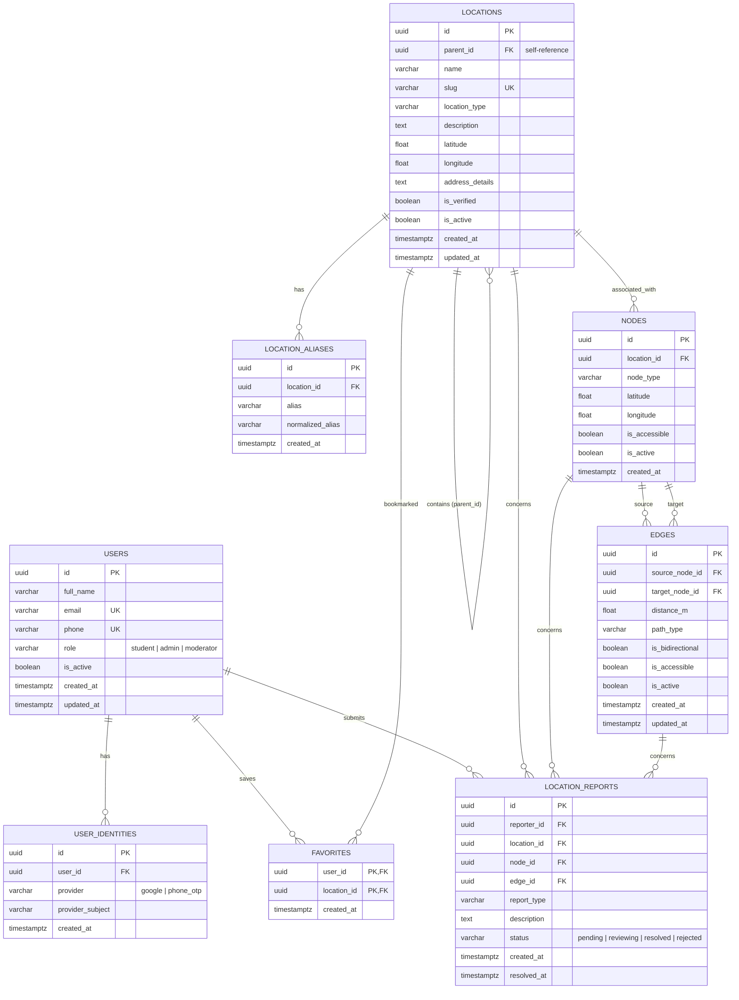

# CampusWay Database Schema Reference (v1)

> **Specification Source:** Team-approved database design documented in [`docs/Db_schema_v1.pdf`](file:///docs/Db_schema_v1.pdf).
> **Database Engine:** PostgreSQL 16 (Shared Neon PostgreSQL / Local Developer Instances).
> **ORM & Migrations:** SQLAlchemy 2.0+ and Alembic.

---

## 1. Architectural Decisions

1. **Primary Keys**: UUIDs generated at application level (`uuid.uuid4`) and database level (`gen_random_uuid()`) for distributed scalability and safe external referencing.
2. **Timestamps**: All timestamps use PostgreSQL's `TIMESTAMPTZ` (`DateTime(timezone=True)` in SQLAlchemy) initialized to UTC current timestamp.
3. **Soft Deactivation vs Destructive Deletion**: Core navigation assets (`locations`, `nodes`, `edges`) support `is_active` flags. When a location or pathway is under construction or deprecated, it is marked inactive (`is_active = FALSE`) to preserve graph integrity and report history.
4. **Graph Representation**:
   - Navigation nodes (`nodes`) represent physical waypoints, entrances, junctions, staircases, and ramps.
   - Walkable edges (`edges`) connect nodes with positive metric distances (`distance_m > 0`).
   - Bidirectional pathways (`is_bidirectional = TRUE`) permit traversal in both directions (`source -> target` and `target -> source`) with equal weight `distance_m`. Directed pathways (`is_bidirectional = FALSE`) permit traversal only from `source` to `target`.
5. **Decoupled Authentication Boundary**:
   - The `users` table models application profiles independent of identity providers.
   - The `user_identities` table allows linking one internal user with multiple auth providers (Google OAuth, Phone OTP) without storing passwords or tokens.
   - Authentication flows and authorization middleware are managed independently by the authentication team lead.

---

## 2. Entity Relationship Diagram

---

## 3. Table Definitions & Constraints

### A. `users`
| Column | Type | Nullable | Constraints & Defaults |
| :--- | :--- | :--- | :--- |
| `id` | UUID | No | Primary Key (`uuid.uuid4`) |
| `full_name` | VARCHAR(120) | Yes | Nullable until profile completion |
| `email` | VARCHAR(255) | Yes | Unique when present |
| `phone` | VARCHAR(20) | Yes | Unique when present |
| `role` | VARCHAR(20) | No | Default `'student'`, check in `('student', 'admin', 'moderator')` |
| `is_active` | BOOLEAN | No | Default `TRUE` |
| `created_at` | TIMESTAMPTZ | No | Default current timestamp |
| `updated_at` | TIMESTAMPTZ | No | Default current timestamp, auto-updated |

### B. `user_identities`
| Column | Type | Nullable | Constraints & Defaults |
| :--- | :--- | :--- | :--- |
| `id` | UUID | No | Primary Key (`uuid.uuid4`) |
| `user_id` | UUID | No | Foreign Key -> `users.id` (ON DELETE CASCADE) |
| `provider` | VARCHAR(30) | No | e.g. `'google'`, `'phone_otp'` |
| `provider_subject` | VARCHAR(255) | No | Stable external identity subject ID |
| `created_at` | TIMESTAMPTZ | No | Default current timestamp |

**Indexes & Constraints:**
- `UNIQUE (provider, provider_subject)`
- `INDEX (user_id)`

### C. `locations`
| Column | Type | Nullable | Constraints & Defaults |
| :--- | :--- | :--- | :--- |
| `id` | UUID | No | Primary Key (`uuid.uuid4`) |
| `parent_id` | UUID | Yes | Self Foreign Key -> `locations.id` (ON DELETE SET NULL) |
| `name` | VARCHAR(180) | No | Destination name |
| `slug` | VARCHAR(200) | No | Unique URL-friendly slug |
| `location_type` | VARCHAR(40) | No | e.g. `'building'`, `'block'`, `'room'`, `'gate'`, `'food_court'` |
| `description` | TEXT | Yes | Rich overview / instructions |
| `latitude` | DOUBLE PRECISION | Yes | Check: `latitude >= -90.0 AND latitude <= 90.0` |
| `longitude` | DOUBLE PRECISION | Yes | Check: `longitude >= -180.0 AND longitude <= 180.0` |
| `address_details` | TEXT | Yes | Floor number, wing, or landmark instructions |
| `is_verified` | BOOLEAN | No | Default `FALSE` |
| `is_active` | BOOLEAN | No | Default `TRUE` |
| `created_at` | TIMESTAMPTZ | No | Default current timestamp |
| `updated_at` | TIMESTAMPTZ | No | Default current timestamp, auto-updated |

**Indexes & Constraints:**
- Check: `parent_id != id` (prevent self-referencing hierarchy)
- Indexes on `parent_id`, `location_type`, `is_active`
- Unique on `slug`

### D. `location_aliases`
| Column | Type | Nullable | Constraints & Defaults |
| :--- | :--- | :--- | :--- |
| `id` | UUID | No | Primary Key (`uuid.uuid4`) |
| `location_id` | UUID | No | Foreign Key -> `locations.id` (ON DELETE CASCADE) |
| `alias` | VARCHAR(180) | No | Display alias (e.g., "Audi", "Mech Block") |
| `normalized_alias` | VARCHAR(180) | No | Normalized search token (e.g., "audi", "mech block") |
| `created_at` | TIMESTAMPTZ | No | Default current timestamp |

**Indexes & Constraints:**
- `UNIQUE (location_id, normalized_alias)`
- `INDEX (normalized_alias)`

### E. `nodes`
| Column | Type | Nullable | Constraints & Defaults |
| :--- | :--- | :--- | :--- |
| `id` | UUID | No | Primary Key (`uuid.uuid4`) |
| `location_id` | UUID | Yes | Foreign Key -> `locations.id` (ON DELETE SET NULL) |
| `node_type` | VARCHAR(40) | No | `'entrance'`, `'junction'`, `'staircase'`, `'ramp'`, etc. |
| `latitude` | DOUBLE PRECISION | No | Check: `latitude >= -90.0 AND latitude <= 90.0` |
| `longitude` | DOUBLE PRECISION | No | Check: `longitude >= -180.0 AND longitude <= 180.0` |
| `is_accessible` | BOOLEAN | No | Default `TRUE` |
| `is_active` | BOOLEAN | No | Default `TRUE` |
| `created_at` | TIMESTAMPTZ | No | Default current timestamp |

**Indexes & Constraints:**
- Indexes on `location_id`, `is_active`

### F. `edges`
| Column | Type | Nullable | Constraints & Defaults |
| :--- | :--- | :--- | :--- |
| `id` | UUID | No | Primary Key (`uuid.uuid4`) |
| `source_node_id` | UUID | No | Foreign Key -> `nodes.id` (ON DELETE CASCADE) |
| `target_node_id` | UUID | No | Foreign Key -> `nodes.id` (ON DELETE CASCADE) |
| `distance_m` | DOUBLE PRECISION | No | Metric distance, check `distance_m > 0` |
| `path_type` | VARCHAR(40) | No | Default `'footpath'` (`'stairs'`, `'ramp'`, `'crossing'`) |
| `is_bidirectional` | BOOLEAN | No | Default `TRUE` |
| `is_accessible` | BOOLEAN | No | Default `TRUE` |
| `is_active` | BOOLEAN | No | Default `TRUE` |
| `created_at` | TIMESTAMPTZ | No | Default current timestamp |
| `updated_at` | TIMESTAMPTZ | No | Default current timestamp, auto-updated |

**Indexes & Constraints:**
- Check: `source_node_id != target_node_id` (prevent self-loops)
- Check: `distance_m > 0`
- Indexes on `(source_node_id, is_active)` and `(target_node_id, is_active)`

### G. `favorites`
| Column | Type | Nullable | Constraints & Defaults |
| :--- | :--- | :--- | :--- |
| `user_id` | UUID | No | Composite PK, FK -> `users.id` (ON DELETE CASCADE) |
| `location_id` | UUID | No | Composite PK, FK -> `locations.id` (ON DELETE CASCADE) |
| `created_at` | TIMESTAMPTZ | No | Default current timestamp |

**Indexes & Constraints:**
- Composite Primary Key `(user_id, location_id)`
- Index on `user_id`

### H. `location_reports`
| Column | Type | Nullable | Constraints & Defaults |
| :--- | :--- | :--- | :--- |
| `id` | UUID | No | Primary Key (`uuid.uuid4`) |
| `reporter_id` | UUID | Yes | Foreign Key -> `users.id` (ON DELETE SET NULL) |
| `location_id` | UUID | Yes | Foreign Key -> `locations.id` (ON DELETE SET NULL) |
| `node_id` | UUID | Yes | Foreign Key -> `nodes.id` (ON DELETE SET NULL) |
| `edge_id` | UUID | Yes | Foreign Key -> `edges.id` (ON DELETE SET NULL) |
| `report_type` | VARCHAR(40) | No | e.g. `'missing_place'`, `'wrong_pin'`, `'blocked_path'` |
| `description` | TEXT | Yes | Issue description |
| `status` | VARCHAR(20) | No | Default `'pending'`, check in `('pending', 'reviewing', 'resolved', 'rejected')` |
| `created_at` | TIMESTAMPTZ | No | Default current timestamp |
| `resolved_at` | TIMESTAMPTZ | Yes | Nullable timestamp populated upon resolution |

**Indexes & Constraints:**
- Check: `location_id IS NOT NULL OR node_id IS NOT NULL OR edge_id IS NOT NULL`
- Index on `status`

---

## 4. Operational Boundaries & Graph Integrity Policies

### A. Authorization & Security Boundaries (Pending Auth Handoff)
- **Safe Public Endpoints**: Location search, location details, location hierarchy, active nodes, active edges, Dijkstra route calculation, map report submission, and visitor help requests are public read/write without authentication.
- **Administrative Operations**: Location creation/update/deactivation, alias addition, node/edge creation/deactivation, and report review/status resolution require administrative privileges (`X-Admin-Key` or `Authorization: Bearer <admin-key>`). Unauthenticated calls are rejected with HTTP 401 Unauthorized; invalid tokens return HTTP 403 Forbidden.
- **User-Scoped Operations**: User favorites require a verified user identity (`X-User-ID` or `Authorization: Bearer <user-id>`). Users can only query, add, or delete their own bookmarks.

### B. Duplicate Edge Policy
- An active edge from `source` to `target` with the same `path_type` is rejected as an exact duplicate.
- If an active bidirectional edge already exists from `target` to `source`, creating an edge from `source` to `target` with the same `path_type` is rejected as redundant.
- If an active directed edge exists from `target` to `source`, attempting to create an overlapping bidirectional edge is rejected with instructions to update or replace the existing directed edge.

### C. Graph Loading & Dijkstra Pathfinding Guarantees
- Only active nodes (`is_active = TRUE`) are loaded into the navigation graph.
- An edge is only registered if **both** its source and target nodes exist and are active. Deactivating either endpoint automatically isolates the edge during route calculations.
- When `accessible_only = TRUE`, the engine filters both accessible nodes (`is_accessible = TRUE`) and accessible edges, guaranteeing wheelchair-compliant paths from origin to destination.
- Dijkstra search uses a dynamic distance map (`best_dist`) to ensure optimal time complexity and prevent priority queue bloat.
